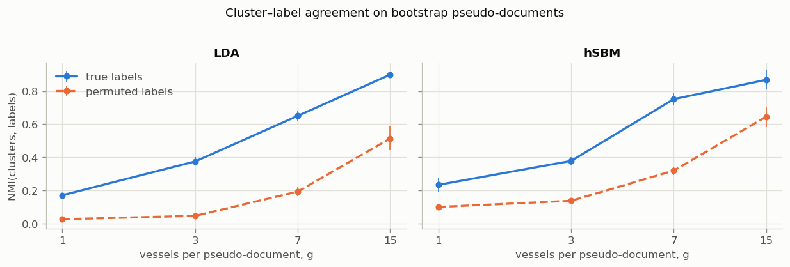
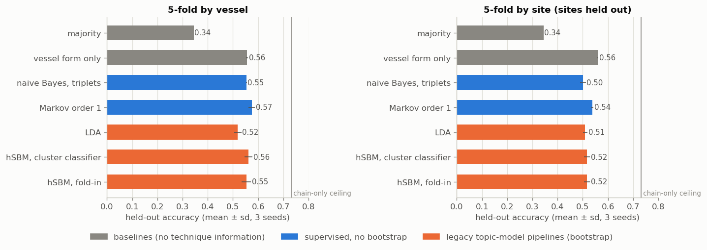

# Ceramic network inference

**Which community made this pot, and what is missing from its production sequence?**
Probabilistic and network models of ceramic *chaînes opératoires* — the ordered sequence of techniques used to make a vessel — applied to 276 Neolithic vessels from the Netherlands recorded by Kroon (2024): Corded Ware (CW, 3000–2350 BCE) and three phases of Funnel Beaker West (FBW, 4000–2800 BCE).

```
Wet clay > Modelling > Coiling > Pressure > Scraping > Wet smoothing > Simple incision > Leather-hard > Dry > Open firing
```

The main notebook, [`notebooks/ceramic_network_inference.ipynb`](notebooks/ceramic_network_inference.ipynb), is a step-by-step account with all results. It addresses three questions:

1. **Attribution** — given the chain of a new vessel, which body of knowledge (BoK) made it?
2. **Reconstruction** — given an incomplete chain, which steps are missing?
3. **Relations** — how different are the BoKs, and what do they share?

## Approach

Kroon (2024) compares BoKs through the edge weights $p(x_{t+1}\mid x_t)$ of a network of techniques. The earlier notebook (`legacy/Presentation_topic_modelling.ipynb`) treats triplets of consecutive techniques as words and vessels as documents, and fits two topic models. The main notebook replicates it **step by step with the same functions**, checked and corrected (`src/chaine/topic_model.py`, `src/chaine/sbm.py`; every docstring cites the legacy cell and its corrections). All models then go through **one protocol**: fitted on training vessels only, scored on held-out sites, and cross-validated.

| model | role |
|---|---|
| LDA on triplets (`LDA_manual`, collapsed Gibbs; gensim cross-check) | legacy topic-model pipeline |
| Hierarchical SBM (`sbmtm` + graph-tool: several starts, merge-split refinement, posterior sampling, fold-in of new vessels by description length) | legacy network topic model, completed |
| Markov chains of order 0–3 with hierarchical Dirichlet smoothing and Kroon's grammar | sequence likelihoods, attribution, exact top-k completion of gaps |
| Maximum Caliber | maximum-entropy distributions over chains; links the Markov models to a physical principle |

## Key results

- **Replication.** The legacy topic-model notebook is reproduced step by step with its own functions. Scored in-sample as there, the hSBM classifies 0.59–0.64 of the vessels correctly (legacy: 0.65), and at level 1 its pseudo-document groups coincide with the four BoKs (NMI 0.92).
- **Much of that separation comes from the bootstrap.** Pseudo-documents built from randomly permuted labels still yield clusters that "recover" them (hSBM NMI ≈ 0.3 at the legacy setting, ≈ 0.6 at 15 vessels per document). On single vessels the hSBM groups are only weakly related to BoK (NMI ≈ 0.15), and MDL rejects the overlapping SBM.
- **Honest accuracy is modest.** With whole sites held out, every technique-based model (LDA, both hSBM classifiers, naive Bayes, Markov) reaches 0.50–0.54 for four BoKs, against 0.34 for the majority class and a ceiling of 0.73 imposed by identical chains in different BoKs. CW vs FBW: ≈ 0.80–0.83.
- **Vessel form is a strong confounder.** Form alone gives 0.56 (four BoKs) and 0.80 (CW vs FBW); the chain adds information beyond form, mainly for the FBW phases.
- **LDA vs hSBM.** The hSBM infers 26 topics and reproduces the cultures' triplet distributions far more closely than LDA's four (JS 0.006 vs 0.042 bits); for attribution the two are equivalent, and LDA's probabilities are the best calibrated.
- **Sequences and reconstruction.** Pairs of steps (Kroon's edge weights) carry almost all sequential information; one hidden step is recovered exactly for 67–75 % of held-out vessels (top-3 ≈ 95 %). Kroon's Wasserstein comparison is invariant to relabelling edges; edge-aware distances agree that CW is farthest from late FBW.

<p align="center">
  <br>
  
</p>

## Repository layout

```
├── notebooks/ceramic_network_inference.ipynb   main narrative, executed
├── src/chaine/            topic_model (legacy LDA pipeline), sbm (+ vendored sbmtm), classifiers,
│                          evaluation, data, markov, distances, reconstruction, maxcal, plotting
├── data/source/           verbatim files from Kroon's DANS deposit (CC-BY-4.0)
├── data/clean/            tidy CSVs built by scripts/prepare_data.py
├── scripts/prepare_data.py
├── figures/               figures saved by the notebook
├── tests/test_core.py
└── legacy/                the two original exploratory notebooks (outputs stripped)
```

## Getting started

```bash
conda env create -f environment.yml        # graph-tool comes from conda-forge (Linux/macOS; WSL on Windows)
conda activate ceramic-network-inference
python scripts/prepare_data.py             # optional: rebuild data/clean (add --download to refetch from DANS)
pytest tests/                              # or: python tests/test_core.py
jupyter lab notebooks/ceramic_network_inference.ipynb
```

The notebook runs top to bottom in about 20 minutes on a laptop. Without graph-tool the hSBM parts are skipped; without gensim its LDA cross-check is skipped. Tested with Python 3.11, numpy 1.26, scipy 1.16, pandas 3.0, scikit-learn 1.8, matplotlib 3.10, graph-tool 2.98, gensim 4.4.

## Data and credits

Data: Kroon, E.J. (2024), *Serial Learners*, Sidestone Press, [doi:10.59641/4e367hq](https://doi.org/10.59641/4e367hq); appendices on DANS, [doi:10.17026/AR/FAXIOW](https://doi.org/10.17026/AR/FAXIOW), CC-BY-4.0. See [`data/README.md`](data/README.md) for files, columns and known quirks.

`src/chaine/sbmtm.py` is vendored unmodified from [martingerlach/hSBM_Topicmodel](https://github.com/martingerlach/hSBM_Topicmodel) (Gerlach, Peixoto & Altmann 2018), licensed GPL-3.0.

## License

Not yet chosen. Because `sbmtm.py` is GPL-3.0, the repository as a whole must be distributed under a GPL-3.0-compatible license, or `sbmtm.py` must be fetched separately instead of vendored. Data remain CC-BY-4.0 (Kroon 2024).

## Citation

See [`CITATION.cff`](CITATION.cff). Please also cite Kroon (2024) for the data and Gerlach et al. (2018) for the hSBM topic model.

## References

- Gerlach, Peixoto & Altmann (2018). A network approach to topic models. *Science Advances* 4: eaaq1360.
- Kroon (2024). *Serial Learners.* Sidestone Press.
- Pressé, Ghosh, Lee & Dill (2013). Principles of maximum entropy and maximum caliber in statistical physics. *Rev. Mod. Phys.* 85: 1115–1141.
- Roux (2019). *Ceramics and Society: A Technological Approach to Archaeological Assemblages.* Springer.
